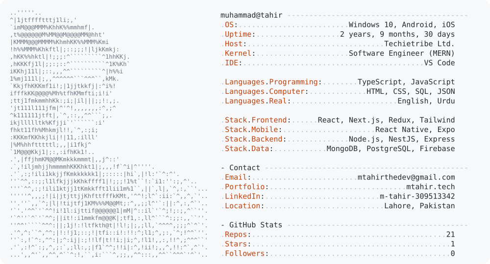

<a href="https://www.mtahir.tech/">
  <picture>
    <source media="(prefers-color-scheme: dark)" srcset="dark_mode.svg" />
    
  </picture>
</a>

<div align="center">

<a href="https://www.mtahir.tech/">
  
</a>

<br/>

<a href="https://www.mtahir.tech/"></a>
<a href="https://linkedin.com/in/tahir-rafiq-60595931a"></a>
<a href="mailto:mtahirthedev@gmail.com"></a>


</div>

---

## About Me

```ts
const tahir = {
  role: "Software Engineer (MERN)",
  company: "Techietribe Ltd.",
  location: "Lahore, Pakistan 🇵🇰",
  focus: ["React Native", "Next.js", "NestJS", "Microservices"],
  currentlyBuilding: "PassTheBill — mobile app + website",
  learning: ["Event-driven architecture", "System design"],
  openTo: ["Collaboration", "Freelance", "Full-time roles"],
  funFact: "I know a lot of useless info about almost everything. Try me.",
};
```

## Tech Stack

<div align="center">


</div>

## Featured Projects

<div align="center">

<a href="https://github.com/mt-panda/shopra-monorepo"></a>
<a href="https://github.com/mt-panda/PassTheBill"></a>
<a href="https://github.com/mt-panda/Echoo"></a>
<a href="https://github.com/mt-panda/rn-store-assignment"></a>
<a href="https://github.com/mt-panda/business-listings-portal-frontend"></a>
<a href="https://github.com/mt-panda/Fitness-Tracker"></a>

</div>

## GitHub Stats

<div align="center">


</div>

## Let's Connect

<div align="center">

Always up for interesting projects, collaborations and a good tech chat.
<br/>
Reach out at **[mtahirthedev@gmail.com](mailto:mtahirthedev@gmail.com)** or check out **[my portfolio](https://www.mtahir.tech/)**.

</div>


